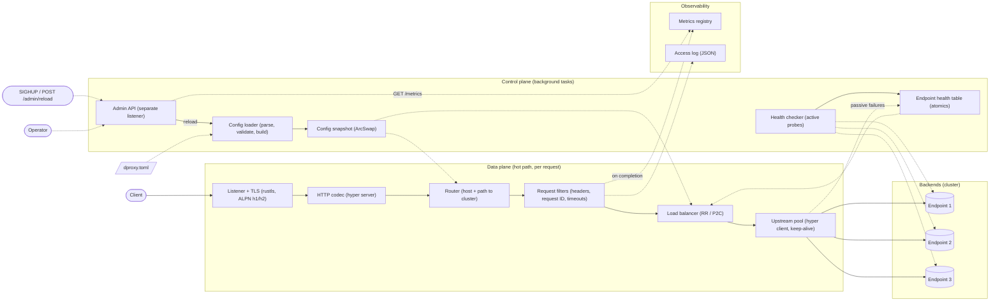

# dproxy: Architecture

The **data plane** carries requests. It runs on every request, so it has to be fast and lock-free.
The **control plane** decides how requests should be handled: config, health and admin. It runs occasionally and is allowed to be slow.
The two planes share exactly two things, both read-only from the data plane:

1. **Config snapshot**: an immutable `Arc<Config>` behind an `ArcSwap`.
2. **Endpoint health table**: per-endpoint atomic state.

## Diagram

Solid arrows show the request path. Dotted arrows show state, config or telemetry.

## Components

| Component | Plane | Its job | Owns | Must never |
|---|---|---|---|---|
| Listener + TLS | Data | Accept TCP connections, terminate TLS, negotiate h1 or h2 via ALPN | Sockets, rustls `ServerConfig` | Block the accept loop |
| HTTP codec | Data | Parse requests and serialize responses, for both h1 and h2 (hyper) | Per-connection state | Buffer whole bodies (stream them) |
| Router | Data | Match host and path to a route, then resolve the route to a cluster | Nothing; reads the snapshot | Take a lock |
| Request filters | Data | Add `X-Forwarded-*` and request ID, strip hop-by-hop headers, apply timeouts and retries | Per-request context | Retry non-idempotent requests |
| Load balancer | Data | Pick one healthy endpoint from the cluster | Per-cluster counters (atomics) | Pick an endpoint marked unhealthy |
| Upstream pool | Data | Reuse connections to backends, open new ones within limits | Idle connections per endpoint | Grow without a limit |
| Config loader | Control | Read the file, parse, validate, build the runtime structures, swap atomically | Nothing persistent | Swap in a config that failed validation |
| Config snapshot | Shared | Hold the current immutable config; in-flight requests keep the version they started with | `ArcSwap<Config>` | Be mutated in place |
| Health checker | Control | Probe each endpoint on an interval, apply rise/fall thresholds | One task per cluster | Share a connection pool with live traffic |
| Endpoint health table | Shared | Hold healthy/unhealthy state per endpoint, written by active checks and passive failures | Atomic flags and counters | Be keyed by anything other than endpoint address (so state survives a reload) |
| Admin API | Control | Serve `/metrics`, `/healthz`, `/ready`, `GET /config`, `POST /reload` on a separate port | Its own listener | Be exposed on the public listener |
| Metrics registry | Shared | Expose RED metrics (rate, errors, duration) per route, cluster and endpoint, plus health and reload counters | Counters and histograms | Use high-cardinality labels (e.g. full path, client IP) |
| Access log | Data | Write one JSON line per request (request ID, route, upstream, status, timings) | Non-blocking writer | Block the request on log I/O |

## Request lifecycle (happy path)

1. The listener accepts the connection. TLS completes and ALPN picks h2 or h1.
2. hyper parses the request head. The body stays a stream.
3. The router loads the current snapshot once and holds that `Arc` for the whole request.
4. Filters add a request ID and `X-Forwarded-For`, strip hop-by-hop headers, and start the request timer.
5. The load balancer reads the health table and picks an endpoint.
6. The upstream pool reuses or opens a connection, then forwards the request and streams the response back.
7. On completion, the proxy records the metrics and writes one access-log line. If the upstream failed, the failure is reported to the health table.
